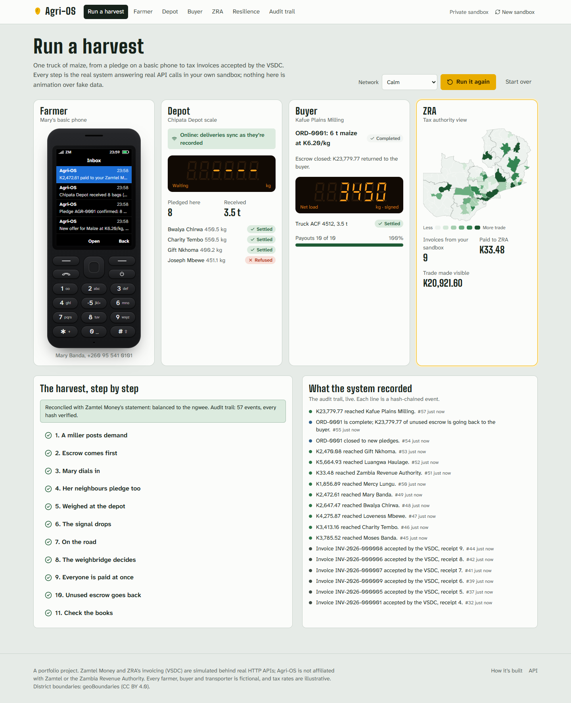
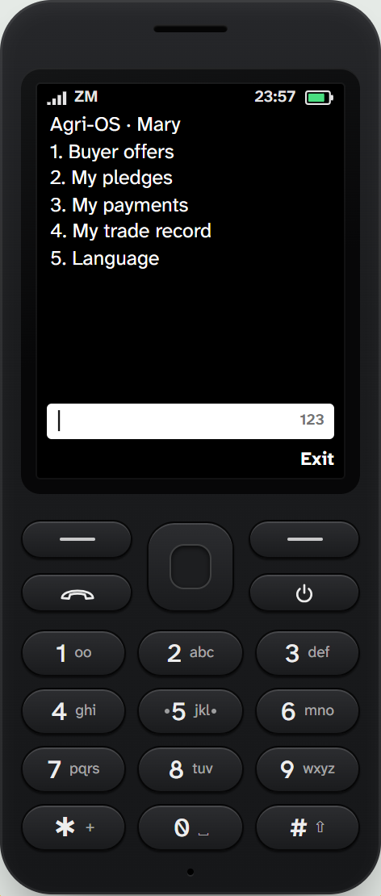
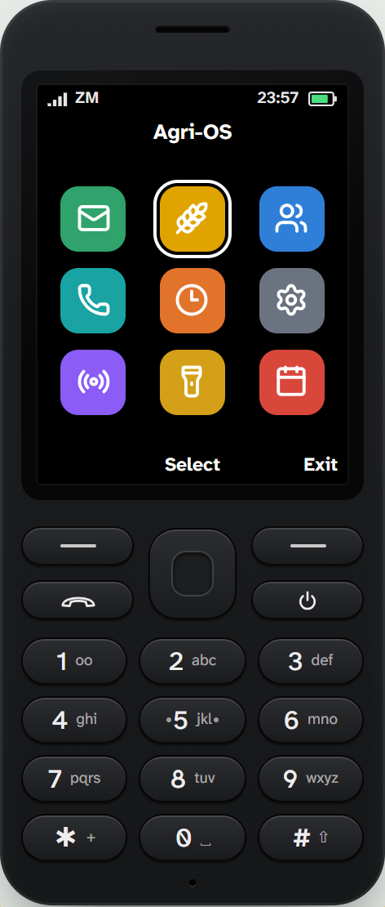
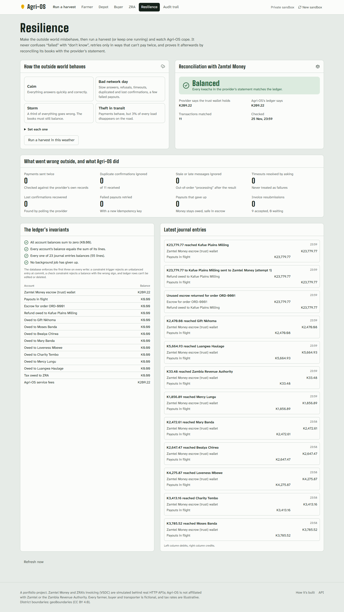
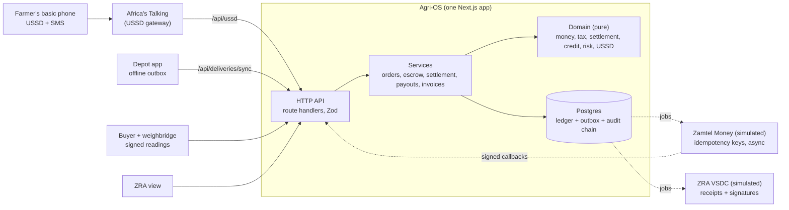

# Agri-OS

**Trade infrastructure for smallholder farmers in Zambia.** A farmer pledges maize from a basic phone, a depot weighs
the bags (with or without signal), the buyer's money waits in escrow, and when the truck crosses the mill's weighbridge
everyone is paid at once through mobile money and every sale gets a tax invoice. The tax authority sees trade that used
to be invisible.

Zamtel Money and ZRA's invoicing (VSDC) are simulated behind real HTTP APIs; everything else is the real system.



## Try it

```bash
docker compose up -d      # Postgres 17 (or set DATABASE_URL to any Postgres 15+)
npm install
npm run setup             # creates .env with a fresh signing key, migrates, seeds
npm run dev               # http://localhost:3000
```

Then press **Run a harvest**. In about a minute you watch one truck of maize go from a pledge on a basic phone to
invoices accepted by the VSDC, with the books reconciled to the ngwee at the end. Every visitor gets a private
sandbox, so nothing you do affects anyone else.

## What's in it

| | |
|---|---|
| **A basic phone that works like one** | USSD on `*384*123#` and SMS, in English, Bemba and Nyanja. The in-browser handset sends exactly the request Africa's Talking would, to the same endpoint. Multi-tap letters, D-pad menus, inbox. |
| **Escrow before anyone delivers** | The buyer approves a Zamtel Money request with a PIN; the order opens to farmers only once the money is there. Unused escrow goes back automatically. |
| **A depot app that works offline** | Deliveries are weighed, moisture-checked and graded, saved on the device (IndexedDB), and synced exactly once when the signal returns. Installable; a service worker opens it offline. |
| **A weighbridge nobody can fudge** | Readings are signed by the device. Farmers are paid on the depot's weight; loss beyond 0.5 % in transit comes out of the haulage fee. |
| **Settlement that can't go wrong** | One balanced ledger entry, then a payout to every farmer, the haulier and ZRA, and an invoice for every sale, all from a transactional outbox. |
| **A chaos switch** | Make the payment provider slow, flaky, forgetful and repetitive, and watch Agri-OS recover. Reconciliation against the provider's statement proves nothing was lost or paid twice. |
| **Records that can't be quietly rewritten** | A hash-chained audit trail with signed checkpoints. Change an amount directly in the database and verification names the event. |
| **A tax-authority view** | Trade by district on a map of all 116 districts, a weekly fair-price index, explained risk flags, CSV export, and tax rules you can edit. |
| **A farmer credit record** | A score built only from what Agri-OS saw, every point explained, shareable with a lender by a code sent over SMS. |

<p>
  
  
</p>

## What keeps the money right

- **Integer ngwee in a double-entry ledger.** The database itself refuses an entry that doesn't balance (a deferred
  constraint trigger), a balance with the wrong sign (a check constraint, so escrow can't be overdrawn even by a race),
  and any edit to a posted line. [ADR 1](docs/adr/0001-integer-ngwee-double-entry-ledger.md)
- **"Unknown" is a payment outcome.** A timeout never becomes "failed". Agri-OS asks the provider, or re-sends with the
  same idempotency key; only a definite failure starts a new attempt with a new key.
  [ADR 2](docs/adr/0002-unknown-is-a-payment-outcome.md)
- **A transactional outbox.** Payouts and invoices are written with the settlement and sent by a Postgres job queue
  (`FOR UPDATE SKIP LOCKED`). No transaction is held open across a network call, and no worker process is needed.
  [ADR 3](docs/adr/0003-transactional-outbox-and-serverless-jobs.md)

More decisions, with the alternatives considered: [farmers paid on depot weight](docs/adr/0004-farmers-paid-on-depot-weight.md),
[reverse invoicing and tax as data](docs/adr/0005-reverse-invoicing-and-tax-as-data.md),
[the USSD replay engine](docs/adr/0006-ussd-replay-engine.md), [a sandbox per visitor](docs/adr/0007-sandbox-per-visitor.md),
[the tamper-evident audit trail](docs/adr/0008-tamper-evident-audit-trail.md).



## Architecture



- `src/domain`: pure business rules with no I/O (money, produce and moisture, transport, tax rules, settlement maths,
  credit score, risk rules, the audit hash chain).
- `src/ussd`: the menu engine and every word a farmer sees, in three languages.
- `src/server`: services, the ledger, the job queue, sandboxes, webhooks, reconciliation.
- `src/integrations`: the simulated Zamtel Money and VSDC, the weighbridge device, and the HTTP/loopback transport.
- `src/app`: 12 pages and the API (39 route handlers). The OpenAPI document is served at `/api/openapi`, and a readable
  version at `/api-docs`.

## Tests

```bash
npm test                # unit, property and integration (integration needs TEST_DATABASE_URL)
npm run e2e             # end to end over HTTP against a running app (add -- --storm for chaos)
npm run e2e:browser     # browser journeys (Playwright)
npm run loadtest        # the USSD endpoint under load
```

- **Property tests** (fast-check): hundreds of random settlements, with random deliveries, transit losses and tax
  rules. Every one must balance, and what the buyer pays must equal exactly what everyone else receives.
- **USSD tests**: every screen, in every language, with worst-case data, must fit 182 characters.
- **Integration tests** run whole harvests against Postgres: one calm, three in a storm of refusals, timeouts, failed
  payouts and lost, duplicated and out-of-order callbacks. They assert that no payout reached the provider twice, every
  farmer's wallet holds exactly what they were owed, the books reconcile with the provider's statement, a forged
  weighbridge reading is refused, and a database-level edit of the audit trail is caught. The storm tests found a real
  liveness bug: a re-sent payout whose callback was then lost had nothing left checking on it.
- **End to end**: 32 checks over real HTTP, calm and in a storm. **Browser**: the guided harvest, the keypad phone and
  tamper detection, in a real browser.
- **Load**: on a 2-core laptop running the app, Postgres and the load generator together, the USSD endpoint served
  139 requests a second (p99 160 ms) on the main menu and 121 a second (p99 164 ms) on the scored trade-record screen,
  with no errors.

CI runs all of it on every push: type-check, lint, the test suites against Postgres, a migration consistency check, the
build, end-to-end calm and storm, and the browser journeys.

## Deploying

Built for Vercel and a managed Postgres (Neon or Supabase): set `DATABASE_URL`, `SIGNING_SEED` and `APP_URL`, run
`npm run db:migrate && npm run db:seed` once, and point a daily cron at `/api/cron` (with `CRON_SECRET`). Background
work runs after requests and on page ticks, so there is no worker to host. To take real USSD traffic, point an
Africa's Talking channel at `/api/ussd`; set `AT_API_KEY` to send real SMS from the live world (seeded demo people
never receive one).

## Honest limits

- Zamtel Money and the VSDC are simulators. They follow the shape of real mobile-money and VSDC integrations, but the
  exact VSDC field mapping must be checked against ZRA's specification (it lives in one file).
- Tax rates are illustrative, not advice. Unprocessed produce is treated as exempt and the produce withholding is off,
  pending confirmation with ZRA.
- The Bemba and Nyanja wording needs a native speaker's review.
- Sandboxes are isolated in the data layer; Postgres row-level security is the next step for a multi-tenant
  production deployment.

## Credits

District and province boundaries: [geoBoundaries](https://www.geoboundaries.org/) (CC BY 4.0); provinces from Zambia
Data Hub, districts from GRID3 and the Office of the Surveyor General. Every farmer, buyer and transporter here is
fictional. Agri-OS is not affiliated with Zamtel or the Zambia Revenue Authority.

## Licence

MIT
